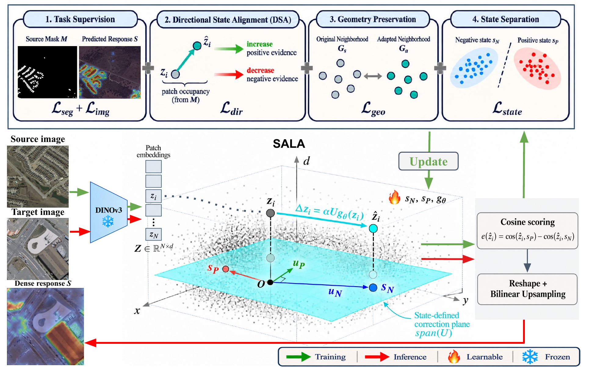

<h1 align="center">SALT</h1>

<p align="center">
  <strong>State-Aligned Low-Rank Transfer for Single-Temporal Cross-Dataset<br>
  Structural Localization in Remote Sensing</strong>
</p>

<p align="center">
  <strong>Accepted at WACV 2027 &middot; GeoCV Workshop</strong><br>
  <a href="https://sites.google.com/view/geocv/home">Workshop</a> |
  <a href="assets/SALT_overview.pdf">Overview PDF</a> |
  <a href="#installation">Installation</a> |
  <a href="#evaluate-released-checkpoints">Evaluation</a> |
  <a href="#train-one-model">Training</a>
</p>

Official PyTorch implementation of **SALT**, accepted at the **Third Workshop
on Computer Vision for Geospatial Image Analysis (GeoCV), WACV 2027**.

SALT learns transferable structural evidence from a labeled source dataset
and localizes it in unseen target images using only the current image.
The release includes training, evaluation, and visualization for
LEVIR-CD to WHU and WHU to LEVIR-CD, with configurations and trained heads
for seeds 111, 222, and 333.

## Overview

<p align="center">
  <a href="assets/SALT_overview.pdf">
    
  </a>
</p>

SALT keeps DINOv3 ViT-L/16 frozen and learns two structural states and a
lightweight coefficient predictor, totaling **67,778 trainable parameters**.
The same states score each patch and define the rank-2 subspace used by
**State-Aligned Low-Rank Adaptation (SALA)**. **Directional State Alignment
(DSA)** supervises the change in structural evidence, while **Geometry
Preservation** penalizes distortion of the pretrained feature relationships.

Training, checkpoint selection, and threshold calibration use only source
data. Target inference requires no pre-event reference image or adaptation.

## Main Pixel Results

Values are percentages, mean +/- sample standard deviation over seeds 111,
222, and 333.

| Transfer | P-AUROC | P-AP | F1 | IoU |
|---|---:|---:|---:|---:|
| LEVIR-CD -> WHU | 98.08 +/- 0.08 | 87.77 +/- 0.21 | 79.59 +/- 0.31 | 66.10 +/- 0.42 |
| WHU -> LEVIR-CD | 94.82 +/- 0.18 | 44.42 +/- 0.98 | 46.24 +/- 2.19 | 30.09 +/- 1.84 |

Checkpoint hashes are in `checkpoints/sha256.json`. The released checkpoints
contain the model weights, configuration, seed, selected epoch, and source
threshold needed for evaluation.

## Installation

Use Python 3.10 and a CUDA-capable PyTorch installation. The retained runs used
PyTorch 2.6.0 and torchvision 0.21.0. For CUDA 12.4:

```bash
python -m venv .venv
source .venv/bin/activate
python -m pip install torch==2.6.0 torchvision==0.21.0 --index-url https://download.pytorch.org/whl/cu124
python -m pip install -r requirements.txt
bash scripts/setup_backbone.sh
```

The setup script checks out the exact official DINOv3 code revision. Obtain
`dinov3_vitl16_pretrain_lvd1689m-8aa4cbdd.pth` through the
[official DINOv3 repository](https://github.com/facebookresearch/dinov3), subject
to its access and license terms, and put it in `weights/`. Commands verify its
full SHA-256 before use. Backbone weights are not included.

## Datasets

Obtain LEVIR-CD and the **aerial building extraction** subset of WHU. The WHU
dataset here uses building-footprint masks, not bi-temporal building-change
masks. Keep one current/post-event LEVIR image per original sample.

Arrange the data as follows, or provide an equivalent directory using
`--data-root`:

```text
data/
  LEVIR/
    train/{B,label}/
    val/{B,label}/
    test/{B,label}/
  WHU3/
    train/{image,label}/
    val/{image,label}/
    test/{image,label}/
```

`WHU3` is the folder identifier for the aerial WHU dataset. The exact filenames,
sample order, and image labels are supplied in `splits/`. Counts are:

| Dataset | Train | Validation | Test |
|---|---:|---:|---:|
| LEVIR-CD | 445 | 64 | 128 |
| WHU | 4,736 | 1,036 | 2,416 |

Validate all files and mask-derived image labels before training:

```bash
python scripts/prepare_data.py --data-root data --check-masks
```

Dataset images are not included. No additional crops or tiles are generated.

## Evaluate Released Checkpoints

```bash
python evaluate.py \
  --checkpoint checkpoints/levir_to_whu/seed111.pt \
  --data-root data \
  --weights weights/dinov3_vitl16_pretrain_lvd1689m-8aa4cbdd.pth \
  --output outputs/levir_to_whu/seed111 \
  --profile
```

For the reverse direction, use `checkpoints/whu_to_levir/seed111.pt`.
Checkpoints for seeds 222 and 333 are supplied in the same folders.
`--device cuda:0` is the default; CPU evaluation is supported with
`--device cpu`. `--dinov3-repo` accepts an existing pinned DINOv3 checkout.

Each output `result.json` contains all six pixel/image metrics and the source
threshold. `--save-predictions` retains the dense raw maps and masks; these
can consume several GiB. By default, temporary maps are removed after scoring.

## Train One Model

```bash
python train.py \
  --config configs/levir_to_whu.yaml \
  --seed 111 \
  --data-root data \
  --weights weights/dinov3_vitl16_pretrain_lvd1689m-8aa4cbdd.pth \
  --output runs/levir_to_whu/seed111
```

Use `configs/whu_to_levir.yaml` for WHU source training. Train for all ten
epochs, select the maximum source-validation P-AP checkpoint with P-AUROC as
the tie-breaker, and estimate a single source-validation F1 threshold. The
target test split is accessed only by `evaluate.py`.

`best.pt` includes the head, configuration, selected epoch, and source
threshold. `last.pt` also preserves optimizer and RNG states. Add `--resume`
to continue an interrupted run from its last completed epoch.

## Run Both Directions and All Seeds

The launcher queues one experiment per currently idle GPU. It runs training
and evaluation, skips completed evaluations, resumes interrupted training,
and writes a log for every stage.

```bash
bash scripts/run_all.sh \
  --data-root data \
  --weights weights/dinov3_vitl16_pretrain_lvd1689m-8aa4cbdd.pth \
  --output runs
```

To select GPU IDs explicitly, append `--gpus 0 1 2 3`. To continue after a
terminal disconnect:

```bash
nohup bash scripts/run_all.sh \
  --data-root data \
  --weights weights/dinov3_vitl16_pretrain_lvd1689m-8aa4cbdd.pth \
  --output runs > salt_run.log 2>&1 < /dev/null &
```

The launcher creates `runs/summary.csv` and `runs/summary.json` after all six
evaluations. To summarize your completed evaluations manually:

```bash
python scripts/summarize.py --root runs --output outputs/summary
```

## Visualize Predictions

```bash
python visualize.py \
  --checkpoint checkpoints/levir_to_whu/seed111.pt \
  --data-root data \
  --weights weights/dinov3_vitl16_pretrain_lvd1689m-8aa4cbdd.pth \
  --index 1 \
  --output outputs/example
```

This exports the RGB image, ground truth, continuous heatmap, raw score array,
source-thresholded mask, and a combined PNG/PDF. `--index` selects a sample in
the fixed target manifest. Heatmap normalization is for display only.

## Configuration and Scoring

| Setting | LEVIR-CD source | WHU source |
|---|---:|---:|
| Residual scale | 0.25 | 2.0 |
| DSA weight | 0.50 | 1.0 |
| DSA margin | 0.10 | 0.20 |
| Geometry weight | 0.10 | 0.10 |
| Top pooling ratio | 0.0025 | 0.0025 |
| Gaussian sigma | 4 | 0 |

Both configurations use the final DINOv3 layer, 518 x 518 input/output maps,
a 32 x 32 token grid, a 1024-64-2 coefficient predictor with GELU and dropout
0.1, 4,096 sampled geometry pairs per image, ten epochs, batch size two,
AdamW (learning rate 0.001, weight decay 0.01), and gradient clipping at 1.0.
One deterministic random horizontal/vertical flip combination is used per
training image per epoch. Source validation uses no augmentation.

The raw patch logit is `cos(z_hat, q_A) - cos(z_hat, q_N)`, with no logit
scale. Training focal, Dice, and image BCE use the unsmoothed dense logits.
DSA uses fractional mask occupancy on the patch grid. Inference optionally
smooths the raw dense map and uses it directly for ranking and thresholding.
Image scores average the top `max(1, floor(rho * H * W))` dense responses.
No target-dependent normalization or target threshold search is performed.

`--profile` measures the backbone and SALT forward pass at batch size one,
with ten warmup passes and fifty measured passes. It excludes data loading,
CPU Gaussian filtering, and metric computation. It reports peak *allocated*
CUDA memory, which differs from total device memory shown by `nvidia-smi`.

## Code Map and Tests

```text
salt/model.py       SALA and structural evidence
salt/losses.py      Focal, Dice, image BCE, state separation, DSA, geometry
salt/backbone.py    Frozen official DINOv3 wrapper
salt/data.py        Fixed splits, preprocessing, and augmentation
salt/metrics.py     Pixel/image metrics and source threshold selection
salt/engine.py      Dense prediction and latency measurement
train.py            Source-only training and calibration
evaluate.py         Frozen target evaluation
visualize.py        Qualitative outputs
```

Run CPU checks with `OMP_NUM_THREADS=2 python -m pytest -q`. Tests check the
parameter count, constrained correction, loss gradients, score/threshold
handling, released checkpoint loading, and artifact integrity.

All reported standard deviations use `ddof=1`. Small numerical variations may
occur across hardware and library versions. See `NOTICE.md` for release and
upstream licensing information.
